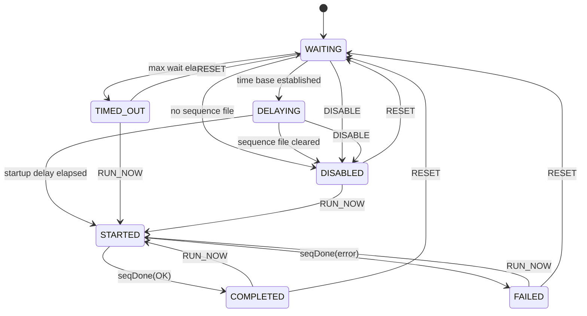

## Introduction

The `StartupSeq` component is a helper component that will start a sequence when software is started. It allows a system to implement automatic behavior to configure the system or perform other startup behaviors. It does this by defining a parameter that stores the file name of the sequence to run. It can also be configured with a `TimeBase` value that will cause it to pause execution until time in the specified `TimeBase` has been established. It is mean to be paired with a `Svc/CmdSequencer` instance that will run the supplied sequence.

A further parameter specifies a delay, in seconds, that is applied after the configured time base has been established (or immediately, if no time base is required) and before the sequence is requested. This allows the rest of the system to finish initializing before startup behavior begins.

Ground commands let an operator request the sequence immediately, cancel the pending request, or re-arm the component. These commands act on the current run of the software only — in particular, the `DISABLE` command is a one-shot cancellation of the pending request, not a persistent setting that stops the sequence from running on future restarts. Use the sequence file name parameter to control startup behavior across restarts.

## Requirements

`StartupSeq` performs **deadline-driven (cyclic)** work: it is periodically invoked by a rate group, and on each invocation it advances through its startup conditions — first waiting for the configured time base to be established, then waiting out the configured delay. Once both conditions are met it issues a single sequence-run request and then remains dormant. The work per cycle is bounded and trivial, so no thread of its own is required.

The component is a one-shot: it requests its sequence at most once per arming. An operator may force the request early, cancel it, or re-arm the component by ground command.

All component state is held in memory only, so **every command affects the current run of the software and nothing beyond it**. In particular the `DISABLE` command cancels the request that is currently pending; it is not a persistent setting that suppresses startup behavior on future restarts. After a restart the component is armed again and will request its sequence as configured. The supported way to stop the startup sequence from running on subsequent restarts is to clear the sequence file name parameter and save it to the parameter database.

### States

The startup logic is modeled as an FPP internal state machine, `StartupMachine`, so the
states and legal transitions are declared in the model rather than encoded in C++
branching.

| State | Description |
|---|---|
| `WAITING` | Armed and waiting for the required `TimeBase` to be established |
| `DELAYING` | The time-base precondition is satisfied; waiting out the startup delay |
| `STARTED` | The sequence has been requested; waiting for the sequencer to report the outcome |
| `COMPLETED` | The sequence ran and the sequencer reported success |
| `FAILED` | The sequence ran and the sequencer reported failure |
| `TIMED_OUT` | The required `TimeBase` was not established within the maximum wait; the sequence was not requested |
| `DISABLED` | The pending request was cancelled by command, or no sequence file is configured (either at the outset or cleared during the startup delay). Applies to this run of the software only |

`WAITING` is the state entered at initialization. `COMPLETED`, `FAILED`, `TIMED_OUT` and
`DISABLED` are terminal for the automatic path: the component takes no further action on
a tick, and leaves them only by command.



### Requirements Table

| ID | Shall Statement | Rationale | Verification Method |
|---|---|---|---|
| REQ-StartupSeq-001 | `StartupSeq` shall store the file name of the sequence to run at startup in a runtime-configurable parameter. | The sequence to run is deployment- and operations-specific, and must be changeable without rebuilding software. | Unit Test |
| REQ-StartupSeq-002 | `StartupSeq` shall accept, as configuration supplied at initialization, the `TimeBase` value that must be established before the startup sequence is requested. | Startup sequences often must not run until the system has valid time (e.g. spacecraft clock) so that sequence time tags and recorded telemetry are meaningful. The required time base is fixed by the deployment's time architecture, so it is configured rather than commanded. | Unit Test |
| REQ-StartupSeq-003 | `StartupSeq` shall store, in a runtime-configurable parameter, the maximum amount of time it will wait for the configured `TimeBase` to be established. | Waiting forever leaves the system in an indeterminate startup state with no operator-visible bound; the bound must be tunable per deployment. | Unit Test |
| REQ-StartupSeq-004 | `StartupSeq` shall store, in a runtime-configurable parameter, a startup delay in seconds to be applied after the time-base precondition is satisfied and before the startup sequence is requested. | Startup behavior often must not begin until the rest of the system has finished initializing; the settling time is deployment-specific. | Unit Test |
| REQ-StartupSeq-005 | On each periodic invocation while in the `WAITING` state, `StartupSeq` shall compare the time base of the current system time against the configured required `TimeBase`. | Time-base establishment is asynchronous with respect to software startup, so it must be polled. | Unit Test |
| REQ-StartupSeq-006 | When the time base of the current system time matches the configured required `TimeBase`, `StartupSeq` shall transition from the `WAITING` state to the `DELAYING` state. | Separates the two startup preconditions so that each is independently observable and independently bounded. | Unit Test |
| REQ-StartupSeq-007 | When the configured required `TimeBase` is `TB_DONT_CARE`, `StartupSeq` shall transition to the `DELAYING` state on its first periodic invocation without waiting for any time base to be established. | Deployments that have no time-base precondition must be able to use the component without incurring a wait or a timeout, while still honoring the startup delay. | Unit Test |
| REQ-StartupSeq-008 | While in the `DELAYING` state, `StartupSeq` shall accumulate and retain the elapsed time since it entered that state. | Needed to determine when the startup delay of REQ-StartupSeq-009 has elapsed. | Unit Test |
| REQ-StartupSeq-009 | When the elapsed time in the `DELAYING` state reaches the startup delay parameter value, `StartupSeq` shall request the startup sequence. | Implements the configured settling time before startup behavior begins. | Unit Test |
| REQ-StartupSeq-010 | When the startup delay parameter value is zero, `StartupSeq` shall request the startup sequence on the same periodic invocation that satisfies the time-base precondition. | A zero delay must mean no delay, rather than one rate-group cycle of delay. | Unit Test |
| REQ-StartupSeq-011 | `StartupSeq` shall request that the sequence named by the sequence file name parameter be run, with an empty sequence argument set. | This is the component's primary function: hand the startup sequence off to a sequencer once the preconditions hold. | Unit Test |
| REQ-StartupSeq-012 | `StartupSeq` shall request the startup sequence at most once per arming. | The component implements automatic startup behavior, not periodic re-execution; repeated requests would restart or disrupt a running sequence. | Unit Test |
| REQ-StartupSeq-013 | After requesting the startup sequence, `StartupSeq` shall transition to the `STARTED` state and shall take no further action on subsequent periodic invocations. | Bounds the component's work and makes the one-shot behavior observable. | Unit Test |
| REQ-StartupSeq-014 | While in the `WAITING` state, `StartupSeq` shall accumulate and retain the elapsed time spent waiting for the configured `TimeBase`. | Needed to enforce the timeout of REQ-StartupSeq-015 and to report the wait to operators (REQ-StartupSeq-023). | Unit Test |
| REQ-StartupSeq-015 | When the elapsed wait time in the `WAITING` state reaches the maximum wait parameter value without the configured `TimeBase` being established, `StartupSeq` shall transition to the `TIMED_OUT` state, shall not request the startup sequence, and shall emit a warning event reporting the configured and current time bases. | Running a time-critical startup sequence without valid time can be worse than not running it; the decision to proceed is left to the operator, who is alerted by the event. | Unit Test |
| REQ-StartupSeq-016 | The maximum wait of REQ-StartupSeq-003 shall apply only to time spent waiting for the configured `TimeBase`, and shall not cause a timeout while the startup delay is elapsing. | The two waits bound different conditions; a settling delay longer than the time-base timeout must not be misreported as a time-base failure. | Unit Test |
| REQ-StartupSeq-017 | If the sequence file name parameter is empty when `StartupSeq` would otherwise request the sequence, `StartupSeq` shall not issue the request, shall emit a warning event, and shall transition to the `DISABLED` state. | An unconfigured or mis-uploaded parameter must surface as operator-visible telemetry rather than as a malformed request or an assertion failure. | Unit Test |
| REQ-StartupSeq-018 | If a parameter cannot be loaded at initialization, `StartupSeq` shall operate using that parameter's default value. | The component must reach a determinate, reportable state on a system with no stored parameter database (e.g. first boot). | Unit Test |
| REQ-StartupSeq-019 | `StartupSeq` shall accept a command to request the startup sequence immediately, regardless of state, of whether the configured `TimeBase` has been established, and of whether the startup delay has elapsed. | Gives operators a manual path to run startup behavior after a timeout, or to start it early during integration and test. | Unit Test |
| REQ-StartupSeq-020 | `StartupSeq` shall accept a command that cancels the pending startup sequence request for the current run of the software and transitions the component to the `DISABLED` state. | Operators need to prevent automatic startup behavior when the system is in an off-nominal configuration. Scoping the command to the current run keeps it a recovery action rather than a configuration change; persistent suppression is achieved by clearing the sequence file name parameter. | Unit Test |
| REQ-StartupSeq-021 | `StartupSeq` shall accept a command that re-arms the component, transitioning it to the `WAITING` state and clearing both the accumulated time-base wait time and the accumulated startup delay time. | Allows startup behavior to be retried, and allows the effect of the cancel command to be undone, without a software restart. Stale accumulators would shorten or skip the next wait. | Unit Test |
| REQ-StartupSeq-022 | `StartupSeq` shall report its current state as a telemetry channel. | Operators must be able to tell whether startup behavior is pending, delaying, has run, timed out, or was cancelled. | Unit Test |
| REQ-StartupSeq-023 | `StartupSeq` shall report, as a telemetry channel, the elapsed time since it was armed. | Read alongside the state channel, this lets operators see progress toward the timeout or toward the end of the startup delay, and diagnose slow startup after the fact. | Unit Test |
| REQ-StartupSeq-024 | `StartupSeq` shall emit an activity event reporting the sequence file name when it requests the startup sequence. | Records the single most significant action the component takes. | Unit Test |
| REQ-StartupSeq-025 | `StartupSeq` shall emit an activity event reporting the configured startup delay when it enters the `DELAYING` state. | Marks time-base establishment in the event log and tells operators how long startup behavior will be withheld. | Unit Test |
| REQ-StartupSeq-026 | While in the `WAITING` state, `StartupSeq` shall emit a throttled activity event reporting the configured and current time bases. | Gives visibility into the wait without flooding the event log once per rate-group cycle. | Unit Test |
| REQ-StartupSeq-027 | `StartupSeq` shall emit an event, including the command arguments where present, describing the action taken for each command it executes. | Command effects must be reconstructable from the event log. | Unit Test |
| REQ-StartupSeq-028 | `StartupSeq` shall respond to a command that is invalid for its current state with a command failure status and shall emit a warning event identifying the rejected command and the current state. | Operator errors must be reported rather than silently ignored or allowed to corrupt the one-shot behavior. | Unit Test |
| REQ-StartupSeq-029 | Each `StartupSeq` event emission shall be uniquely traceable to a single call site, either by being emitted from exactly one site or by carrying an argument whose value differs at every site. | Required by the F Prime C++ design principles (CPP-36) so that an event in the log identifies the code path that produced it. | Inspection |
| REQ-StartupSeq-030 | `StartupSeq` shall accept, as configuration supplied at initialization, the period of the rate group driving its periodic invocation, and shall use it to convert elapsed invocations into elapsed seconds. | The component counts invocations rather than differencing system time, because system time is by definition unreliable while it waits for a time base to be established. The period is fixed by the topology, so it is configured rather than commanded. | Unit Test |
| REQ-StartupSeq-031 | `StartupSeq` shall accept, from the paired sequencer, a report that the requested startup sequence has finished, including whether it succeeded. | Without it the component cannot tell a sequence that is still running from one that has finished, and so cannot safely decide whether a second request would disrupt a running sequence. | Unit Test |
| REQ-StartupSeq-032 | On being reported that the sequence finished successfully, `StartupSeq` shall transition to the `COMPLETED` state and emit an activity event. | Records the successful completion of startup behavior and releases the component to accept commands again. | Unit Test |
| REQ-StartupSeq-033 | On being reported that the sequence finished unsuccessfully, `StartupSeq` shall transition to the `FAILED` state and emit a warning event reporting the response. | A failed startup sequence is an operator-actionable condition that must be distinguishable, in state as well as in events, from a successful one. | Unit Test |
| REQ-StartupSeq-034 | While in the `STARTED` state, `StartupSeq` shall reject every command with a command failure status and a warning event. | While a requested sequence is in flight the request cannot be recalled, and re-arming would allow the automatic path to issue a second request into the running sequence, violating REQ-StartupSeq-012. | Unit Test |
| REQ-StartupSeq-035 | `StartupSeq` shall reject the cancel command in any state in which no startup sequence request is pending. | Cancelling is meaningful only while a request is pending; accepting it otherwise would report success for an action that had no effect. | Unit Test |
| REQ-StartupSeq-036 | `StartupSeq` shall respond to every command it receives, including commands it rejects and commands received while more commands are outstanding than it can track. | A command that receives no response hangs in the command dispatcher. | Unit Test |
| REQ-StartupSeq-037 | `StartupSeq` shall re-check that a sequence file is configured on each periodic invocation while the startup delay is elapsing, and shall not request a sequence if the sequence file name has become empty. | The sequence file name parameter is the documented way to disable startup behavior, and it can be cleared by command while the delay is still running. Requesting an empty file name makes the sequencer run whichever sequence is already resident rather than nothing. | Unit Test |
| REQ-StartupSeq-038 | `StartupSeq` shall apply a parameter update to its own behavior no later than its next periodic invocation. | The autocoded parameter-set command runs on the caller's thread, so the update cannot be applied to the component's working state at the instant it arrives without a data race. | Unit Test |

### Interface Summary

Data exchanged with other components; port types are a design-phase decision.

| Direction | Data | Peer |
|---|---|---|
| Input | Periodic invocation (rate-group cycle, with cycle context) | Rate group driver |
| Input | Operator commands: request sequence now, cancel pending request, re-arm | Command dispatcher |
| Input | Parameter values: sequence file name, maximum time-base wait, startup delay | Parameter database |
| Input | Initialization configuration: required `TimeBase`, rate group period | Topology setup code |
| Input | Current system time, including its time base | Time source |
| Output | Sequence-run request: sequence file name and (empty) sequence arguments | `Svc::CmdSequencer` instance, or another sequencer accepting the same request |
| Input | Report that the requested sequence finished, and whether it succeeded | The same paired sequencer |
| Output | Events, telemetry channels, command responses | Event logger, telemetry channel database, command dispatcher |

## Design

### Component Kind

`StartupSeq` is an **active** component. Although the work per cycle is trivial and
deadline-driven, an active component is used so that the rate-group cycle and the
three ground commands all arrive as messages on a single queue and are therefore
serialized without explicit locking. The startup state machine and its wait
accumulators are touched only from the component's own thread.

`schedIn` is an `async input port`: the cycle is enqueued rather than executed in the
rate-group thread. A missed or late cycle only shifts the resolution of the startup
delay, which is not a hard deadline.

The component is also required to be `active` (or `queued`) because it holds an FPP
internal state machine instance: state machine signals are delivered through the
component's message queue, so a `passive` component has nowhere to deliver them. Using
the queue for the tick, the sequence-done report and all three commands means the state
machine itself is driven from a single thread and needs no locking.

**One exception, and it is handled explicitly.** The autocoded `PARAM_SET` / `PARAM_SAVE`
commands are *not* queued: `cmdIn_handlerBase` dispatches them inline, so
`parameterUpdated()` runs on the calling component's thread (normally the command
dispatcher's), not on this component's thread. Refreshing the parameter cache there
would race with the state machine guards reading it. `parameterUpdated()` therefore only
sets an atomic stale flag; `schedIn_handler` tests and clears that flag and refreshes the
cache on the component thread, where the guards read it. The cache is consequently
written from exactly one thread and needs no lock of its own.

A parameter update is therefore applied on the next tick rather than instantly. At a
1 Hz rate group that is a sub-second delay in a startup path already measured in
seconds.

### Timekeeping

Elapsed time is measured by **counting `schedIn` invocations**, not by differencing
system time. While the component is in `WAITING` the required time base is by
definition not yet established, so system time is unreliable or absent precisely when
the timeout must be enforced; and when time is acquired it may jump discontinuously.
The rate group period supplied to `configure()` converts the cycle count into elapsed
seconds, so the resolution of both the timeout (REQ-StartupSeq-015) and the startup
delay (REQ-StartupSeq-009) is the rate-group period. `timeCaller` is read each cycle
only to inspect the *time base* of the current time, never to measure a duration.

### Ports

| Kind | Port Name | Port Type | Rationale |
|---|---|---|---|
| `async input` | `schedIn` | `Svc.Sched` | Rate-group cycle drives the state machine. Async so state is touched only from the component thread; the startup delay is not a hard deadline. |
| `output` | `seqRunOut` | `Svc.CmdSeqIn` | Carries the sequence file name and an (empty) `Svc.SeqArgs`. Connects directly to `CmdSequencer.seqRunIn`; also accepted by `FpySequencer` and `SeqDispatcher`. |
| `async input` | `seqDoneIn` | `Fw.CmdResponse` | The paired sequencer's report that the sequence finished. Connects to `CmdSequencer.seqDone`. Async so the report is serialized with the tick and the commands on one queue. |
| `async input` | `pingIn` | `Svc.Ping` | Active component, so it participates in health checking. Deliberately *not* `drop`: a dropped ping is an unanswered ping, which `Svc::Health` escalates to a `FATAL` (and typically a system reset). The ping is queued so a momentarily full queue delays the response rather than guaranteeing a missed one. |
| `output` | `pingOut` | `Svc.Ping` | Ping response. |
| `command recv` | `cmdIn` | — | Receives the three ground commands. |
| `command reg` | `cmdRegOut` | — | Command registration. |
| `command resp` | `cmdResponseOut` | — | Command completion status, including the rejections of REQ-StartupSeq-028. |
| `event` | `logOut` | — | Events. |
| `text event` | `logTextOut` | — | Text events. |
| `telemetry` | `tlmOut` | — | Telemetry channels. |
| `time get` | `timeCaller` | — | Supplies event/telemetry time tags, and the time base inspected each cycle. |
| `param get` | `prmGetOut` | — | Parameter load. |
| `param set` | `prmSetOut` | — | Parameter save. |

### Configuration vs. Parameters

The component's configuration is split by whether a value is a static property of the
system or an operational setting:

| Value | Mechanism | Rationale |
|---|---|---|
| Required time base | `configure()` argument | Fixed by the deployment's time architecture — which clock the system has and whether startup must wait for it. Not something an operator retunes. |
| Rate group period | `configure()` argument | Fixed by the topology: it must match the rate group wired to `schedIn`. Making it ground-settable would let an operator desynchronize it from the actual wiring. |
| Sequence file, max wait, startup delay | `param` | Operationally meaningful: the sequence to run and how long to wait for it may change across mission phases or in response to observed startup behavior. |

The configuration method is:

```c++
//! Configure the component's static startup properties
void configure(TimeBase requiredTimeBase,  //!< Time base required before the sequence is
                                           //!< requested; TB_DONT_CARE to not wait
               U32 rateGroupPeriodMs       //!< Period of the rate group driving schedIn
);
```

This follows the established `Svc` convention of a public `configure()` for static
properties (`Svc::ActiveRateGroup`, `Svc::DpCatalog`, `Svc::FileManager`, and others).

### Parameters

| Name | Type | Default | Requirement |
|---|---|---|---|
| `SequenceFile` | `string size FileNameStringSize` | `""` | REQ-StartupSeq-001 |
| `MaxTimeBaseWaitSeconds` | `U32` | 60 | REQ-StartupSeq-003 |
| `StartupDelaySeconds` | `U32` | 0 | REQ-StartupSeq-004 |

The defaults are deliberately inert: an empty `SequenceFile` means a component that is
instantiated but never configured requests nothing and reports `DISABLED`, rather than
requesting a sequence that does not exist.

### Commands

| Name | Kind | Arguments | Effect | Valid in | Requirement |
|---|---|---|---|---|---|
| `RUN_NOW` | `async` | none | Requests the sequence immediately, bypassing the time-base wait and the startup delay | Every state but `STARTED` | REQ-StartupSeq-019, -034 |
| `DISABLE` | `async` | none | Cancels the pending request **for this run of the software only** | `WAITING`, `DELAYING` | REQ-StartupSeq-020, -035 |
| `RESET` | `async` | none | Re-arms the component and clears both wait accumulators | Every state but `STARTED` | REQ-StartupSeq-021, -034 |

All three are `async`, so they are serialized with `schedIn` and `seqDoneIn` on the
component queue. None take arguments, so the per-command event of REQ-StartupSeq-027
carries no argument values; each command's effect is reported by its own event
(`SequenceRequestedByCommand`, `StartupCancelled`, `StartupReset`).

**Command validity is decided by the state machine, not by the handler.** A handler
records the command and sends a signal; the action that handles that signal sends the
response. Checking validity in the handler would be a race: the handler reads the
current state, but a tick already queued ahead of the signal can change that state
before the signal is processed, so the handler could report success for a command the
machine then ignores. Putting the accept and reject actions on the transitions makes
the response follow the transition that actually happened.

Because a response is now sent from an action rather than from the handler, the pending
commands are held in a small fixed-size FIFO (`Fw::FifoQueue`, depth 8) rather than in a
single slot: several commands can be dispatched before their signals are processed, and
each must be answered with its own opcode and sequence number. A command arriving when
that queue is full is answered immediately with `BUSY` and a `TooManyCommands` event,
so it cannot hang in the dispatcher (REQ-StartupSeq-036).

#### `DISABLE` is a one-shot cancel, not a persistent setting

`DISABLE` cancels the startup sequence request that is currently pending. It is **not**
a configuration change and does **not** suppress startup behavior on future restarts:
the component holds no non-volatile state and writes no parameter, so a restart arms it
again and it will request its sequence as configured.

This is deliberate. The command exists so that an operator who sees a system come up in
an off-nominal configuration can stop the startup sequence from running *now*, which is
a recovery action under time pressure. Making that same command silently change the
system's configuration for all future boots would overload one opcode with two very
different scopes of consequence.

To suppress the startup sequence across restarts, clear the `SequenceFile` parameter and
save it to the parameter database. The component then emits `NoSequenceFile` and enters
`DISABLED` on each subsequent startup, which distinguishes a deliberately disabled
deployment from one that was cancelled by command this run (`StartupCancelled`).

The `StartupCancelled` event text states the scope explicitly, so the limitation is
visible to an operator reading the event log rather than only to a reader of this
document.

`DISABLE` is rejected in every state where no request is pending, including the terminal
states: reporting success for a cancel that cancelled nothing would mislead an operator
into believing startup behavior had been inhibited.

### Events

| Name | Severity | Arguments | Throttle | Requirement |
|---|---|---|---|---|
| `SequenceRequested` | activity high | `fileName` | — | REQ-StartupSeq-024 |
| `SequenceRequestedByCommand` | activity high | `fileName` | — | REQ-StartupSeq-024, -027 |
| `SequenceCompleted` | activity high | none | — | REQ-StartupSeq-032 |
| `SequenceFailed` | warning high | `response` | — | REQ-StartupSeq-033 |
| `TimeBaseEstablished` | activity high | `required`, `delaySeconds` | — | REQ-StartupSeq-025 |
| `WaitingForTimeBase` | activity low | `required`, `current`, `waitedSeconds` | 5 | REQ-StartupSeq-026 |
| `TimeBaseWaitTimeout` | warning high | `required`, `current`, `waitedSeconds` | 1 | REQ-StartupSeq-015 |
| `StartupCancelled` | warning high | none | — | REQ-StartupSeq-020 |
| `NoSequenceFile` | warning high | none | — | REQ-StartupSeq-017 |
| `SequenceFileClearedWhileDelaying` | warning high | none | — | REQ-StartupSeq-037 |
| `StartupReset` | activity high | none | — | REQ-StartupSeq-021 |
| `TooManyCommands` | warning high | `opcode` | — | REQ-StartupSeq-036 |
| `InvalidCommand` | warning high | `opcode`, `state` | — | REQ-StartupSeq-028, -034, -035 |

Per REQ-StartupSeq-029 every event is traceable to a single call site. This is achieved
by giving each site its own event rather than by sharing an event and distinguishing it
with a reason argument: requesting the sequence automatically and requesting it by
command are `SequenceRequested` and `SequenceRequestedByCommand`; cancelling by command
and finding no sequence file configured are `StartupCancelled` and `NoSequenceFile`.
Finding no sequence file *before* any wait began and finding it cleared *during* the
startup delay are `NoSequenceFile` and `SequenceFileClearedWhileDelaying` — the same
condition, but distinguishing them tells an operator whether the component was never
configured or was disabled part-way through its wait.
`InvalidCommand` is emitted from one action but carries the rejected opcode and the
state, which together identify the rejection.

`TimeBaseWaitTimeout` is throttled at 1 because the timeout is latched — the component
enters `TIMED_OUT` and stops — so a second emission would indicate a logic error rather
than a second timeout. The `RESET` command clears both throttles so a re-armed component
can report a subsequent wait and timeout.

### Telemetry

| Name | Type | Update | Requirement |
|---|---|---|---|
| `State` | `StartupMachine.State` | on change | REQ-StartupSeq-022 |
| `ElapsedSeconds` | `U32` | on change | REQ-StartupSeq-023 |

`State` is typed with the state machine's own generated `State` enum rather than a
hand-maintained copy, so the channel cannot drift from the model.

Both channels are written from `schedIn_handler`, not from a state machine action. The
generated state machine runs both transition and entry actions *before* assigning the
new state, so `getState()` inside any action still returns the previous state; an action
that reported telemetry would report the state being left. Writing from the handler
always observes a settled state. Because both channels are `update on change`, writing
them every cycle costs nothing once the component is idle in a terminal state.

### Types

The states are the states of the `StartupMachine` state machine, and are generated as
`Svc::Svc_StartupMachine::State`. No hand-written state enum is needed.

The `StartReason` and `DisableReason` enums of the earlier design were removed when the
events they distinguished were split into separate events (see Events above).

Opcodes and event/channel/parameter IDs are left unspecified in the model and assigned
by the FPP compiler, so instantiating the component in a topology cannot collide with
another component's hardcoded IDs.

### Verification Status

Unit tests live in `test/ut/` and are registered as `Svc_StartupSeq_ut_exe`. They pass
with **100% line coverage** of `StartupSeq.cpp` (171/171), measured with
`fprime-util check --coverage`.

The suite is **rule-based** (per `fprime-unit-testing` §3: the component is stateful with
multiple interacting ports), backed by traditional per-requirement tests:

| File | Contents |
|---|---|
| `test/ut/TestState/TestState.hpp` | Shadow model: an independent prediction of the state machine, written from the requirements rather than from the implementation |
| `test/ut/Rules/Tick.cpp` | `schedIn` and time-base establishment rules |
| `test/ut/Rules/Commands.cpp` | The three commands and the state-dependent accept/reject matrix |
| `test/ut/Rules/SeqDone.cpp` | Sequence outcome reporting on `seqDoneIn` |
| `test/ut/StartupSeqTester.cpp` | Helpers and 19 traditional per-requirement tests |
| `test/ut/StartupSeqTestMain.cpp` | `TEST` cases with `REQUIREMENT` tags, plus three randomized scenarios |

The three randomized scenarios run 2000 rule applications each across different
configurations (no time base precondition; time base plus delay; time base with no
delay). Because the shadow model predicts each transition independently, a disagreement
in state, events or port output fails the run rather than being silently accepted.

Requirements verified by test rather than inspection carry a `REQUIREMENT("StartupSeq-NNN")`
tag in `StartupSeqTestMain.cpp`, so the mapping from requirement to test is machine-readable.
REQ-StartupSeq-029 (event traceability) and REQ-StartupSeq-030's rationale remain
inspection items.

**Note on the test harness.** A port invocation or command is one queued message, and
the state machine signal it sends is a second. A single `doDispatch()` therefore leaves
the signal unprocessed and the state machine unadvanced; the tester's `drainQueue()`
helper dispatches until the queue is empty. This is worth knowing before adding tests —
the first draft of this suite failed every state assertion for exactly this reason.

### Implementation Notes

**Parameter caching.** The state machine guards are generated `const`, but the
`paramGet_*` functions are not, so a guard cannot read a parameter directly. The three
parameter values are cached in the implementation and refreshed from `parametersLoaded()`
and `parameterUpdated()`. An unset or invalid parameter yields the model default, which
is the inert configuration, so no separate validity handling is required.

**Sequence path length.** `SequenceFile` is declared `string size FW_PARAM_STRING_MAX_SIZE`
(40), not `FileNameStringSize` (240). The generated parameter storage is an
`Fw::ParamString`, and assignment to it truncates silently, so declaring the longer size
would promise a path length the parameter database cannot actually carry. Deployments
needing longer startup sequence paths must raise `FW_PARAM_STRING_MAX_SIZE`.

**Tick saturation.** The elapsed-cycle counter is an `FwSizeType` (CPP-28: a tick count
whose useful range is project-dependent) and saturates at `FwSizeType` maximum rather
than wrapping. `cyclesToSeconds` separately clamps its `U32` result rather than
truncating the high bits. A wrapped or truncated value would read as a short wait and
could satisfy the timeout or delay comparison spuriously.

### Constraints and Assumptions

- The component determines that a time base has been established by inspecting the time base of the system time it reads; a time source that has not acquired time is assumed to report `TB_NONE`.
- The component only *requests* that a sequence be run. Validating, loading, and executing the sequence belong to the paired sequencer; `StartupSeq` records only the pass/fail outcome the sequencer reports.
- **`seqDoneIn` must be connected to the paired sequencer.** If it is not, or if the sequence never finishes, the component remains in `STARTED` indefinitely and rejects all commands. There is deliberately no timeout on `STARTED`: a hung sequence is the sequencer's condition to report, and `Svc::CmdSequencer` has its own timeout. A deployment that cannot guarantee a done report should use the `Svc::Health` ping ports to detect the stall.
- The sequence is requested with an empty argument set; parameterized startup sequences are out of scope.
- Both the maximum time-base wait and the startup delay are enforced in terms of elapsed time accumulated across periodic invocations; the resolution of each is therefore the period of the invoking rate group. A startup delay shorter than that period behaves as a zero delay.
- The rate group period supplied to `configure()` must match the period of the rate group actually connected to `schedIn`. A mismatch scales both the timeout and the startup delay proportionally; the component cannot detect it.
- The component holds no non-volatile state and never writes a parameter of its own accord. Every command therefore affects only the current run of the software; persistent startup behavior is governed solely by the saved `SequenceFile` parameter value.
- `configure()` must be called during topology setup. The first `schedIn` invocation asserts that it has been: running with an assumed rate group period would give a silently wrong timeout and startup delay, and topology setup code is trusted, so a missing call is a programming error rather than an operational condition.
- At most 8 commands may await a state machine response at once. Beyond that, commands are answered `BUSY` rather than queued or dropped. The component's own message queue bounds this in practice; the limit exists so the pending-command FIFO is fixed-size (CPP-1).
- The startup delay is specified in seconds and is applied on every path that reaches the `DELAYING` state, including the `TB_DONT_CARE` case. The force-now command (REQ-StartupSeq-019) is the only way to bypass it.
